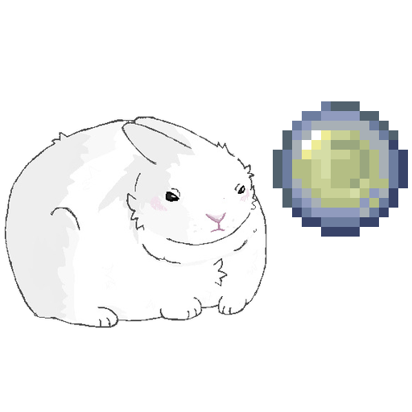

# Better Origins (NeoForge 1.21.1)

**Alpha** — things may still change between versions.

Better Origins is a reworked version of **Origins** for NeoForge. At the start of the game you choose an
*origin*: each one has its own abilities, buffs and weaknesses. Origins can be changed with the `Orb of Origin`
and customised with datapacks.

Better Origins **replaces** Origins: install one or the other, not both. It keeps the same internal ID (`origins`)
and the same content, so **datapacks and addons made for Origins (NeoForge) keep working**, including addons that
add new origins.

## What is different from Origins

- **Reworked origins:** Merling, Blazeborn, Elytrian, Enderian, Arachnid, Shulk, Phantom and Feline have new
  abilities, buffs and weaknesses (kin mobs, fireball, web throw, levitation burst, floating, spectral form,
  shadow veil, pounce and more).
- **New origins:** Road Runner (super speed, stuns), Cave Worm (miner, toxic parasites) and Angel (blessings for
  itself or for everyone nearby).
- **New origin:** Superior Bat: flies at night, sees mobs and players through walls with Echolocation, burns in
  the sun.
- **New origin:** The Perfect Human, with the Adrenaline ability (own sounds, firework burst and red screen effect).
- **Elytrian Wind Charge:** throw up to 3 Breeze wind charges, each recharging in 10 seconds.
- **New origin menu:** origins grouped by impact (Standard, Low, Medium, High) with a coloured background for each
  origin; new icons and ability bars.
- **Removed origin:** Avian.
- **New enchantments:** Sun Protection and Evolved Gills (helmets only).
- **Up to 5 ability keys** (primary G, secondary H, third N, fourth `,`, fifth `.`), all rebindable.
- **Fixes:** origin bonuses no longer stay on the player after changing origin; ability cooldowns reset when you
  respawn; Origins' broken Claustrophobia power file is fixed.
- **Performance:** ability data is sent to clients less often while cooldowns and timers run, entities without
  origins are skipped every tick and no longer get empty origin data saved and sent to every client, and the
  client and server no longer share an unsafe cache in singleplayer.
- **No extra mods needed:** the configuration uses NeoForge's own config system
  (`config/origins-common.toml`, also editable in game from the mod list).

## Changelog

See [`CHANGELOG.md`](CHANGELOG.md).

## Requirements

- Minecraft 1.21.1
- NeoForge 21.1.228 or newer

## Versions

Files are named `better_origins-<Minecraft version>-<mod version>.jar`, for example `better_origins-1.21.1-0.9.2.jar`.
The mod version follows `MAJOR.MINOR.PATCH`: `0.x.x` while in development, new features raise the middle number,
fixes raise the last one.

## Server notes

- Install Better Origins on the server **and** on every player's game.
- The Superior Bat flies: set `allow-flight=true` in `server.properties`, otherwise the server kicks flying players.
- Fast flyers (Elytrian, Superior Bat) generate new terrain quickly: pre-generating the world (for example with the
  Chunky mod) avoids lag spikes.

## Credits

Better Origins is made by **Samulele_borsuk**, based on the work of:

- **IAFEnvoy** and contributors (yuqijun, Mai-xiyu, LukeElrod): [Origins for NeoForge](https://github.com/IAFEnvoy/Origins-NeoForge),
  licensed under `LGPL-3.0`. Better Origins is a modified version of this mod.
- **Apace**: author of the original [Origins mod](https://github.com/Apace100/origins-fabric) (`MIT`).
- **EdwinMindcraft**: author of the [Forge port of Origins](https://github.com/EdwinMindcraft/origins-forge) (`MIT`).
- **UltrusBot**: author of [Alternate Origin GUI](https://github.com/UltrusBot/AltOriginGui) (`MIT`).
- **ChrysanthCow**: author of [Apugli](https://github.com/MerchantCalico/apugli) (`LGPL-3.0`).

Included libraries: Additional Entity Attributes, Caelus API, Integration.

## License

Better Origins is a modified version of Origins (NeoForge) and is distributed under the
**GNU Lesser General Public License v3.0** — see [`LICENSE`](LICENSE).
The full source code of every published version is available in this repository.
See [`NOTICE.md`](NOTICE.md) for the copyright notice of the changes and the origin of the assets.
